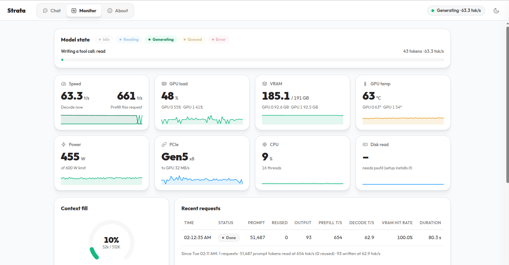

# Local DeepSeek V4.1 Flash 1017 with Project Maya

Local launchers for [Project Maya](https://github.com/mw00/project-maya) and the
existing LibertAIDAI EXL3 checkpoint. The independent `Strata/` fork and its
old generated configuration remain for reference, but their 2.7-bpw packs have
been removed, so they are not a runnable fallback. The root launchers select
Maya. Neither model downloads nor requantization are part of this deployment.

## Configuration

- Maya v1.1.34 at `249f9a87d1a9d72bec2b684d704b0aa9296b1c9c`, with
  `LibertAIDAI/DeepSeek-V4.1-Flash-1017-EXL3-2.9bpw`, revision
  `c178a01284fc5c0e859d8668cffaac81ca8f4042`.
- Two NVIDIA GPUs, layer split (`--tp 1`) with DSpark, mmap experts, vision off
  and suffix drafting disabled. Approximate expert skipping is forced off. Some
  experts can use Maya's CPU lane; this is not the earlier fully resident Strata
  profile.
- The initial context capacity is **32,768**. A larger configurable capacity
  is not evidence that an actual long prompt works on this setup.
- Model shards and the existing Maya pack stay under `STRATA_DATA_DIR`; the
  pack indexes the existing weights rather than duplicating them.
- Local API and browser chat: **http://127.0.0.1:8081** (Qwen keeps `:8080`).

## Commands

Use an existing pinned Maya checkout, engine and prepared pack. They are not
vendored or automatically downloaded by the launchers. For a new checkout:

```bash
git clone https://github.com/lunarmoon26/deepseek-v4.1-flash.git
cd deepseek-v4.1-flash
git clone https://github.com/mw00/project-maya.git Project-Maya
git -C Project-Maya checkout --detach 249f9a87d1a9d72bec2b684d704b0aa9296b1c9c
python3 -m venv .venv
.venv/bin/pip install -r deployment/requirements.txt
cp .env.example .env
```

Edit `.env` with absolute paths to the data directory, Maya checkout, compiled
`maya-ds4` binary and already prepared pack. Set the CUDA device order. The
local build used CUDA 13.4, GCC 15 and SM120. The Maya checkout's serving files
must be clean and its Git revision must match the pin; rebuilding also requires
clean engine sources.

The expected data layout is:

```text
STRATA_DATA_DIR/
  models/LibertAIDAI-DeepSeek-V4.1-Flash-1017-EXL3-2.9bpw/<pinned revision>/
  models/DeepSeek-V4.1-Flash-1017-Engram/
  packs/<existing Maya 2.9 pack>/
```

The 2.9 model links its two Engram shards to the shared directory. The original
2.7 paths remain hard links to those same shards. The other 2.7 source weights
and both 2.7 packs have been removed; the retained 2.7 source index and manifest
no longer describe a complete checkpoint.

Then:

```bash
bash install.sh        # validate existing assets and write config; never starts the model
bash check.sh
bash start.sh          # foreground; Ctrl+C stops it
```

In another terminal:

```bash
bash smoke-test.sh
```

OpenAI clients use `http://127.0.0.1:8081/v1`, model
`deepseek-v4.1-flash-1017`. The server also exposes
`/v1/responses` and `/v1/messages`. Images are not supported. Do not tunnel or
publish the unauthenticated listener. No automatic boot service is installed.

`install.sh` writes an ignored private `logs/maya-deepseek-1017.json`, backing up a
changed configuration and refusing to overwrite a file it does not own. It does
not load the model or start a server. `check.sh` checks the pinned source,
model index, pack shard list and paths; it does not run inference. `start.sh`
takes the shared service lock and launches Maya in the foreground. Explicit
environment assignments override `.env` values. Rerun `install.sh` after changing
paths, GPU order, port, `MAYA_CONTEXT` or `MAYA_SPEC=on|none`. Python defaults
to `.venv/bin/python`; `MAYA_PYTHON` or `DS41_PYTHON` overrides it.

Optional `STRATA_API_KEY` enables API authentication; keep the value in `.env`
or the environment, not Git. The launcher always binds to loopback. Configure
the same key in clients. For a rebuild, `bash build-local.sh` compiles the pinned
Maya `maya-ds4` target without loading weights or downloading a model. It uses
`MAYA_ENGINE`'s parent directory for the build and can replace that binary. The
optional native-GGML expert backend is disabled, matching the tested EXL3 build.

## OpenCode

`deployment/opencode-provider.json` is a **provider fragment**, not a complete
global configuration. Merge it under `providers.strata-deepseek` in your OpenCode
configuration after making a local backup, preserving other providers and defaults.
The selectable ID is **`strata-deepseek/deepseek-v4.1-flash-1017`**, with `fast`
(thinking disabled) and `thinking` variants. The initial fragment describes
32,768 total tokens, an 8,192-token output cap and a 24,568-token input cap.
If you deliberately change `MAYA_CONTEXT`, update the client limit separately;
a larger number alone does not qualify long-context inference.
When API authentication is enabled, configure the provider's `settings.apiKey`
using an environment or file reference available to the OpenCode service; do not
put the key in this repository.
No personal OpenCode configuration or backup is included here.

### Historical Strata OpenCode session



Captured on 2026-10-20 while generating a `read` tool call. The completed request
shown used **51,487 prompt tokens** and **93 output tokens**, with **654 tokens/s
prefill**, **62.9 tokens/s decode** and **100% VRAM expert hit rate**. The monitor
shows **185.1 GB VRAM used** across both GPUs. This is an observed request, not a
controlled throughput benchmark.

## Docker

```bash
docker --context default compose build
bash start-docker.sh
docker --context default compose logs -f
bash stop-docker.sh
```

Set `STRATA_DATA_DIR`, `MAYA_SOURCE_DIR` and `MAYA_PACK_DIR` in `.env` first.
The build takes the pinned local Maya checkout as a separate build context and
compiles `maya-ds4` for SM120; package dependencies are installed, but model
weights are not downloaded. The model and pack mounts are read-only and keep
their absolute paths for Engram reads. Linux host networking preserves loopback
binding. Native and container launchers share a lock. Automatic restart is
disabled, and stopping the container does not remove models, packs or images.
The container writes a separate ignored config and does not overwrite the native one.
The Maya image builds and its engine prints `--help` without a GPU; container
GPU runtime has not yet been qualified.

## Validation

`python3 -m unittest deployment.test_launchers deployment.test_maya_local -v`
runs CPU-only tests for the launcher, source and model identity checks, shared
Engram paths, private configuration, lock exclusion and mocked smoke request.
These tests do not load model weights or use a GPU. The 2.9-bpw model's index
and EXL3 K-map were checked separately. The earlier native Maya trial used a
63-token prompt at 32,768 capacity and matched 96 reference output tokens with
and without DSpark. This is not an actual 32K prompt or a broad quality result.
An earlier reset divergence did not recur in that trial; its cause is not proven.

An isolated run of the installed Maya launcher at 32,768 capacity passed an
authenticated smoke test, rejection of unauthenticated requests, and ten short
real-model API checks: health and model listing, nonstreaming and streaming
chat, verbatim copy, Responses, Messages, a tool call, concurrent request
isolation, disconnect recovery and context-overflow rejection. SIGTERM returned
cleanly. Under a 32-GiB cgroup limit, the run observed no swap or OOM; this is
not an actual long-input, broad quality or Docker GPU qualification. The test
scope was stopped and no service was left running.

### Why Maya is selected

A matched native-engine test compared Maya v1.1.34 with official Strata 0.1.52
at [`5e8a4cca7`](https://github.com/Niko1221/Strata/tree/5e8a4cca7d690ac60ca37eb09e7d0e010099ad6d),
using the same existing 2.9-bpw pack on two RTX PRO 6000 Blackwell GPUs.

| Decode mode | Official Strata | Maya |
| --- | ---: | ---: |
| DSpark disabled (drafter still loaded) | 70.57 tok/s | 81.84 tok/s |
| DSpark enabled | 135.65 tok/s | 150.01 tok/s |

Each mode used eight runs of a 63-token prompt and 96-token greedy answer;
the table gives the last four runs' median. All 32 outputs matched token for
token, with zero prefix reuse. Both engines used 32,768-token capacity, six
experts, layer split, eight CPU threads, a 32-GiB memory limit and no swap.
Maya's suffix drafting and approximate expert skipping were disabled. Both
processes exited cleanly after `QUIT` and input-pipe closure; model and pack
metadata were unchanged. An earlier harness attempt left the pipe open and
timed out at shutdown; its failed receipt was retained separately.

This is one repeatedly warmed short fixture, with one load per engine run
sequentially, not a varied workload, actual 32K input or broad quality test.
OS caches and background GPU activity were not reset. Official Strata's engine
can read this EXL3 pack, but its GGUF-oriented `--pack-info` diagnostic rejects
it; the normal installer is not a drop-in replacement for the Maya deployment.

The following sections record **historical Strata 2.7-bpw** experiments. Their
performance, context and serving claims do not qualify the Maya deployment.

### Grouped-prefill qualification (2026-10-24)

The published engine pin adds **opt-in grouped packed EXL3 prefill**
(`DS41_PF_GROUPED=1`) and resident-stage phase profiling. The reconstructed-GEMM
path remains the default; no launcher preset or generated configuration changes.
The installed local checkout remains at `a3d8196`, layer split + DSpark, with its
service stopped. Publishing this revision does not install or enable it.

Matched native prefill, unchanged pinned weights and 524288 capacity:

| Actual input | Fixture | Default tokens/s | Grouped tokens/s | Speedup |
| ---: | --- | ---: | ---: | ---: |
| 16384 | Source code | 510.976 | 1325.218 | 2.59x |
| 65536 | Retrieval | 1003.757 | 1904.510 | 1.90x |
| 524256 | Retrieval | 833.807 | 1384.878 | 1.66x |

The 16K result uses one warm-up and three timed runs (median 32.064 vs 12.363 s).
The long-input rows each use one prefill per fresh engine, not repeat medians:
65.291 vs 34.411 s at 64K; 628.750 vs 378.557 s at 524256. Both paths select
chunk/batch 512/256 with DSpark enabled and zero prefix reuse. Timings include
prefill allocation, transfers and cleanup, but exclude load, tokenization and HTTP.
The repeated-background retrieval fixture is not a general coding benchmark.

Both paths actually process the full 524256-token prompt, return `BRONZE-73921`,
pass snapshot continuation and finish at position 524262 within 524288 capacity.
The 64K pair passes too. No backbone streaming, cgroup swap or OOM occurs; maximum
observed cgroup memory across the four long cases is 9.36 GiB under a 16 GiB limit,
including file cache. Grouped logits differ numerically but pass the unchanged
equal-argmax, KL <0.02 and relative-L2 <0.25 gates. Default-path logits remain
byte-identical to the published reference on the historical 513-token fixture.

All 15 component CTests and 36 installer/tokenizer/mock-HTTP, six packer and six
wrapper tests pass. The requested 512-batch trial is **not qualified**: its plan
shrinks mid-run and exact replay fails; that partial timing is not adopted.
Actual full-context speculative-decode throughput, independent broad quality,
fresh real-model HTTP and current container GPU runtime remain unqualified.
Full methods, attribution and limits live in the engine's
[`DEEPSEEK_1017.md`](https://github.com/lunarmoon26/Strata-DS/blob/3cda8ac27f40840716c9051b2aa382bdfe3325d0/docs/DEEPSEEK_1017.md).

### Installed deployment baseline (2026-10-20; unchanged)

- Selected profile: **layer split 18/22 + DSpark**, one session, 524288 capacity.
  The persistent service remains stopped; installation does not start it.
- The final matched native coding fixture (63 prompt tokens, 96 greedy outputs,
  one warm-up and three timed runs, median) measures **80.808 tok/s** for layer
  DSpark versus **68.090** without drafting: **18.7%** faster. TP measures
  **41.991** without drafting and **43.026** with DSpark, so remains experimental.
  All outputs match. This is not HTTP throughput or long-context performance.
- Validation uses CUDA 13.4 / GCC 15 / SM120, two RTX PRO 6000 GPUs over PCIe P2P,
  a 16 GiB host-memory limit, no cgroup swap and a two-CPU quota. No weights change.
- All **15 component CTests** pass. Real-model full-logit, prefix-commit,
  rejected-draft rollback, session, drafting and cancellation checks pass in
  layer and TP modes; TP also passes at full configured capacity and in both GPU
  orders. Capacity checks do not count as an actual-524K input run.
- Native-pipe cases cover greedy replay, STOP/recovery, invalid IDs/overflow and
  clean QUIT, including TP drafting with its cache disabled. Layer prefill and
  sequential logits on the 513-token fixture remain byte-identical to the
  previously published binary. The earlier layer native-pipe checks also pass.
- The rebuilt installed binary also passes a native-pipe check using the exact
  selected layer/DSpark configuration at **524288 capacity**: READY, fresh greedy
  replay, STOP/recovery, invalid requests and clean QUIT. This uses short inputs,
  not 524K input tokens, and leaves no persistent server running.
- The latest CPU rerun passes 36 installer/tokenizer/mock-HTTP tests, six packer
  tests and six wrapper tests. Mock HTTP is not real-model HTTP qualification.
- Full-model Nsight-injected runs exit with code 139 before producing a report;
  the cause is unresolved. At this earlier checkpoint, full-model kernel-level
  attribution, fresh real-model HTTP, actual-524K input, independent quality and
  container GPU qualification were incomplete. The later actual-input results
  above cover layer split, not TP2. Failed/cancelled receipts stay private.

### Earlier upstream-port qualification

- The earlier deployment checkout and source pin selected the upstream-based port;
  the native build and generated launcher select `build-sm120-resident/bin/ds41_serve`.
- Runtime qualification used `1d2eb70`; the pinned `a101972` adds only the test
  assertion correction and qualification notes, with identical production code.
- 64 installer/tokenizer/mock-HTTP/packer tests and six deployment-wrapper tests pass.
- All 11 component CTests pass in the qualification checkout. One stale MCG test
  assertion was corrected to expect the earlier resident device-policy
  refusal; no production engine code changed.
- A 513-token real-model case passes retrieval, batched/sequential comparison,
  snapshot restore, deterministic replay and cancellation recovery. Its final
  prefill logits match the historical binary byte for byte.
- The actual 524,256-token rerun and queued follow-up tests were cancelled at the
  user's request. They are not claimed as passing. The newly built deployment
  starts successfully and reports loaded/healthy at 524,288 capacity; fresh live
  API qualification was not completed.
- No model download, requantization, simultaneous model loads or Docker GPU
  qualification took place. The isolated container Python layout imports both
  entrypoints; that is not a container runtime test.

### Historical deployment (`ccd8cf2`)

The real-input ladder passed at 32,768, 131,072, 262,144 and **524,256 tokens**.
The final test generated the expected `BRONZE-73921`; prefill took **531.73 s
(985.95 tokens/s)** and the complete native test took 552.90 s, with no swap/OOM
or backbone expert streaming. This is a synthetic repeated-filler retrieval
fixture, not a broad long-context benchmark or an HTTP throughput measurement.

Native serving passes real-model OpenAI streaming/nonstreaming, Responses,
Anthropic Messages, tool calls, concurrent session isolation, disconnect/recovery,
context overflow rejection and browser chat. At that revision, eight stage/component
CTest cases, 32 packer tests and 27 protocol/parser/cancellation tests pass.
Published DSpark execution, confidence, replay and live API arithmetic pass;
suffix mode passes the real API checks. These functional checks are not a broad
coding-agent quality benchmark or evidence that speculation is faster. The
running default therefore uses ordinary decode (`DS41_SPEC=none`).

The preceding real-model measurements qualify the historical `ccd8cf2` binary,
not the upstream port. The historical Strata source pin is in
`deployment/strata-source.json`.
Raw local receipts and failures are not published here.
This repository publishes portable launchers and templates, not `.env`, device
UUIDs, private client configuration, model links, weights, builds or logs.
