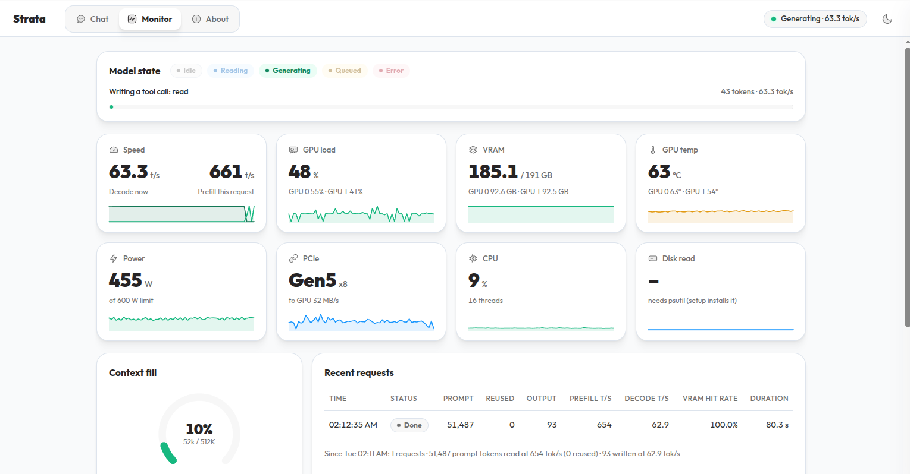

# Local DeepSeek V4.1 Flash 1017 with Strata

Standalone launchers for the native [Strata-DS engine](https://github.com/lunarmoon26/Strata-DS).
The engine and its Git history live in **`Strata/`**, independently of this
deployment repository. Model-specific settings are not copied from Qwen.

## Configuration

- Only `sudoingx/DeepSeek-V4.1-Flash-1017-EXL3-2.7bpw`, revision
  `22205b9aff07ae7b999d466aaf96446c20f4ea97`.
- Two RTX PRO 6000 Blackwell GPUs, resident layers 0–17 / 18–39. The heavier
  first stage uses the headless GPU. No backbone CPU fallback or expert eviction.
- Selected profile: **layer split + DSpark**, one session, with a bounded
  MTP-only GPU cache (1024 MiB ceiling). Experimental TP is not selected.
- Capacity **524,288**. Published YaRN factor 16 remains unchanged.
- Models and lossless packs stay under the configured `STRATA_DATA_DIR`.
  `Strata-data/` provides convenient links; it does not duplicate weights.
- Local API and browser chat: **http://127.0.0.1:8081** (Qwen keeps `:8080`).

## Commands

Clone the pinned engine separately; it is not vendored or automatically updated:

The engine pin selects the upstream-based resident backend and native 1017
installer. The local native service uses this revision; validation completed
so far and remaining limits are listed below. The older SAGE installer is not used.

```bash
git clone https://github.com/lunarmoon26/deepseek-v4.1-flash.git
cd deepseek-v4.1-flash
git clone https://github.com/lunarmoon26/Strata-DS.git Strata
git -C Strata checkout --detach a3d8196bb64c50b9994536738629ad7b6f982297
python3 -m venv .venv
.venv/bin/pip install -r deployment/requirements.txt
cp .env.example .env
```

Edit `.env` with your **absolute data directory**, CUDA device order and optional
tool paths. Use a CUDA toolkit compatible with SM120 (the native build was
validated with CUDA 13.4 and GCC 15). No model download or quantization is run by
these commands. The pinned source identity is in `deployment/strata-source.json`.

Provision the verified source model and lossless pack under this data layout:

```text
STRATA_DATA_DIR/
  models/sudoingx-DeepSeek-V4.1-Flash-1017-EXL3-2.7bpw/<pinned revision>/
  packs/sudoingx-1017-22205b9a-EXL3-2.7bpw-dspark/
```

Engram files must remain available independently of obsolete model directories.
The `-dspark` pack includes the published MTP experts; no Qwen-style standalone
`mtp/` directory is required. Optional `Strata-data/models/` and
`Strata-data/packs/` links can point to the data disk; they stay out of Git.

Then:

```bash
bash build-local.sh
bash install.sh        # validate existing assets; generate config + launcher; never starts the model
bash check.sh
bash start.sh          # foreground; Ctrl+C stops it
```

In another terminal:

```bash
bash smoke-test.sh
```

OpenAI clients use `http://127.0.0.1:8081/v1`, model
`deepseek-v4.1-flash-1017` (alias `strata`). The server also exposes
`/v1/responses` and `/v1/messages`. Images are not supported. Do not tunnel or
publish the unauthenticated listener. No automatic boot service is installed.

Like Qwen's workflow, `install.sh` delegates to **Strata's `setup.sh`** using the
explicit `--family deepseek --model 1017-EXL3-2.7BPW --configure-only` profile.
The fork generates **`Strata/strata-deepseek-1017.json`** and
**`Strata/run-deepseek-1017.sh`**. `start.sh` delegates to that generated launcher;
launching does not regenerate configuration. The installer reuses the existing
engine, model, pack and Python environment: no downloads, build, quantization,
GPU loading or automatic start. It is safe to install while the server is running.
Generated files are private and excluded from both repositories; changed generated
files are backed up, and files not owned by this installer are never overwritten.

The configuration writer and preflight/smoke helper now belong to the fork's
`tools/setup_deepseek_1017.py`; there is no separate deployment configuration
writer. The generated launcher executes Strata's own `serve/server.py` using
the installed configuration after preflight. Native options are documented in
`Strata/docs/DEEPSEEK_1017.md`, under "Build and configure".
The wrappers load ignored `.env` defaults; explicit environment assignments win.
Python defaults to `.venv/bin/python` (`DS41_PYTHON` overrides it).
Set installation options in `.env` or pass them to `bash install.sh`, then rerun
the installer whenever paths, Python, GPU order, port or serving options change.
For example, `DS41_SPEC=none bash install.sh` disables drafting; changes take effect on the next
manual restart, not on the currently running server. `DS41_PORT` selects a different
**localhost** port. `DS41_SPEC=none|suffix|dspark`
selects greedy drafting; this deployment defaults to `dspark` with layer split.
`DS41_PARALLEL=2` enables two isolated concurrent sessions with serial GPU
scheduling, not fused batch acceleration. Batch decode and sampled requests use
ordinary decoding, even when a drafter is loaded. The verifier batches tentative
rows and commits accepted state without backbone replay. DSpark uses the actual
published MTP weights; draft experts alone use bounded streaming and an MTP-only
GPU LRU, never backbone eviction or requantization. The measured short coding
fixture benefits; other prompts, sampled requests and long contexts are not
promised a speedup. Strata's engine CLI still defaults to speculation off;
these wrappers explicitly select the deployment profile.

To rebuild the current local source: `bash build-local.sh`. The native resident
targets and component tests build under `Strata/build-sm120-resident/`; the build
does not run GPU tests or load weights. No download or model
conversion occurs. CMake and Ninja are found in `.venv/bin` or `PATH`;
`DS41_CMAKE`, `DS41_NINJA` and `CUDACXX` override them. `DS41_CUDA_VISIBLE_DEVICES`
sets CUDA ordering independently of physical `DS41_TELEMETRY_GPUS` monitoring IDs.

## OpenCode

`deployment/opencode-provider.json` is a **provider fragment**, not a complete
global configuration. Merge it under `providers.strata-deepseek` in your OpenCode
configuration after making a local backup, preserving other providers and defaults.
The selectable ID is **`strata-deepseek/deepseek-v4.1-flash-1017`**, with `fast`
(thinking disabled) and `thinking` variants. Context is 524,288 total, with an
8,192-token output cap and input limited to 516,088 for the native safety margin.
No personal OpenCode configuration or backup is included here.

### OpenCode in use



Captured on 2026-10-20 while generating a `read` tool call. The completed request
shown used **51,487 prompt tokens** and **93 output tokens**, with **654 tokens/s
prefill**, **62.9 tokens/s decode** and **100% VRAM expert hit rate**. The monitor
shows **185.1 GB VRAM used** across both GPUs. This is an observed request, not a
controlled throughput benchmark.

## Docker

```bash
docker --context default compose build
bash start-docker.sh
docker --context default compose logs -f
bash stop-docker.sh
```

Set an absolute `STRATA_DATA_DIR` in `.env` before using Compose. Builds compile
the local `Strata/` checkout for SM120 and install Python/CUDA dependencies, but
never download weights. Model and pack mounts are read-only and keep their
absolute paths for Engram row reads. Linux host networking preserves loopback
binding. The native and container launchers share a lock; do not load a competing
model onto the same GPUs simultaneously. Automatic restart is disabled. Stop removes the container, not
models, packs or images. The earlier image built successfully; rebuild it for
the installer workflow. GPU container runtime validation is not completed.
The selected local deployment uses the native launcher, not Docker. The
persistent service remains stopped until an explicit `bash start.sh`.
Containers generate their own configuration from the mounted assets before
delegating to the same generated launcher; host-generated paths are not baked in.

## Validation

`python3 -m unittest deployment/test_launchers.py -v` runs six CPU-only wrapper
tests for environment precedence and delegation to the native installer, launcher
and checks. `python3 Strata/tools/test_setup_deepseek_1017.py -v` tests the native
profile, including idempotent installation, private files/backups, refusal to
overwrite user files, shell quoting, direct server delegation, lock exclusion and
occupied-port rejection. These tests do not load model weights or use a GPU.

### Current deployment (2026-10-20)

- Selected profile: **layer split 18/22 + DSpark**, one session, 524288 capacity.
  The persistent service remains stopped; installation does not start it.
- The final matched native coding fixture (63 prompt tokens, 96 greedy outputs,
  one warm-up and three timed runs, median) measures **80.808 tok/s** for layer
  DSpark versus **68.090** without drafting: **18.7%** faster. TP measures
  **41.991** without drafting and **43.026** with DSpark, so remains experimental.
  All outputs match. This is not HTTP throughput or long-context performance.
- Validation uses CUDA 13.4 / GCC 15 / SM120, two RTX PRO 6000 GPUs over PCIe P2P,
  a 16 GiB host-memory limit, no cgroup swap and a two-CPU quota. No weights change.
- All **15 component CTests** pass. Real-model full-logit, prefix-commit,
  rejected-draft rollback, session, drafting and cancellation checks pass in
  layer and TP modes; TP also passes at full configured capacity and in both GPU
  orders. Capacity checks do not count as an actual-524K input run.
- Native-pipe cases cover greedy replay, STOP/recovery, invalid IDs/overflow and
  clean QUIT, including TP drafting with its cache disabled. Layer prefill and
  sequential logits on the 513-token fixture remain byte-identical to the
  previously published binary. The earlier layer native-pipe checks also pass.
- The rebuilt installed binary also passes a native-pipe check using the exact
  selected layer/DSpark configuration at **524288 capacity**: READY, fresh greedy
  replay, STOP/recovery, invalid requests and clean QUIT. This uses short inputs,
  not 524K input tokens, and leaves no persistent server running.
- The latest CPU rerun passes 36 installer/tokenizer/mock-HTTP tests, six packer
  tests and six wrapper tests. Mock HTTP is not real-model HTTP qualification.
- Full-model Nsight-injected runs exit with code 139 before producing a report;
  the cause is unresolved. Full-model kernel-level attribution, fresh real-model
  HTTP, actual-524K input, independent numerical/quality and container GPU
  qualification remain incomplete. Failed/cancelled receipts stay private.

### Earlier upstream-port qualification

- The earlier deployment checkout and source pin selected the upstream-based port;
  the native build and generated launcher select `build-sm120-resident/bin/ds41_serve`.
- Runtime qualification used `1d2eb70`; the pinned `a101972` adds only the test
  assertion correction and qualification notes, with identical production code.
- 64 installer/tokenizer/mock-HTTP/packer tests and six deployment-wrapper tests pass.
- All 11 component CTests pass in the qualification checkout. One stale MCG test
  assertion was corrected to expect the earlier resident device-policy
  refusal; no production engine code changed.
- A 513-token real-model case passes retrieval, batched/sequential comparison,
  snapshot restore, deterministic replay and cancellation recovery. Its final
  prefill logits match the historical binary byte for byte.
- The actual 524,256-token rerun and queued follow-up tests were cancelled at the
  user's request. They are not claimed as passing. The newly built deployment
  starts successfully and reports loaded/healthy at 524,288 capacity; fresh live
  API qualification was not completed.
- No model download, requantization, simultaneous model loads or Docker GPU
  qualification took place. The isolated container Python layout imports both
  entrypoints; that is not a container runtime test.

### Historical deployment (`ccd8cf2`)

The real-input ladder passed at 32,768, 131,072, 262,144 and **524,256 tokens**.
The final test generated the expected `BRONZE-73921`; prefill took **531.73 s
(985.95 tokens/s)** and the complete native test took 552.90 s, with no swap/OOM
or backbone expert streaming. This is a synthetic repeated-filler retrieval
fixture, not a broad long-context benchmark or an HTTP throughput measurement.

Native serving passes real-model OpenAI streaming/nonstreaming, Responses,
Anthropic Messages, tool calls, concurrent session isolation, disconnect/recovery,
context overflow rejection and browser chat. At that revision, eight stage/component
CTest cases, 32 packer tests and 27 protocol/parser/cancellation tests pass.
Published DSpark execution, confidence, replay and live API arithmetic pass;
suffix mode passes the real API checks. These functional checks are not a broad
coding-agent quality benchmark or evidence that speculation is faster. The
running default therefore uses ordinary decode (`DS41_SPEC=none`).

The preceding real-model measurements qualify the historical `ccd8cf2` binary,
not the upstream port. Current source is pinned in `deployment/strata-source.json`.
Raw local receipts and failures are not published here.
This repository publishes portable launchers and templates, not `.env`, device
UUIDs, private client configuration, model links, weights, builds or logs.
